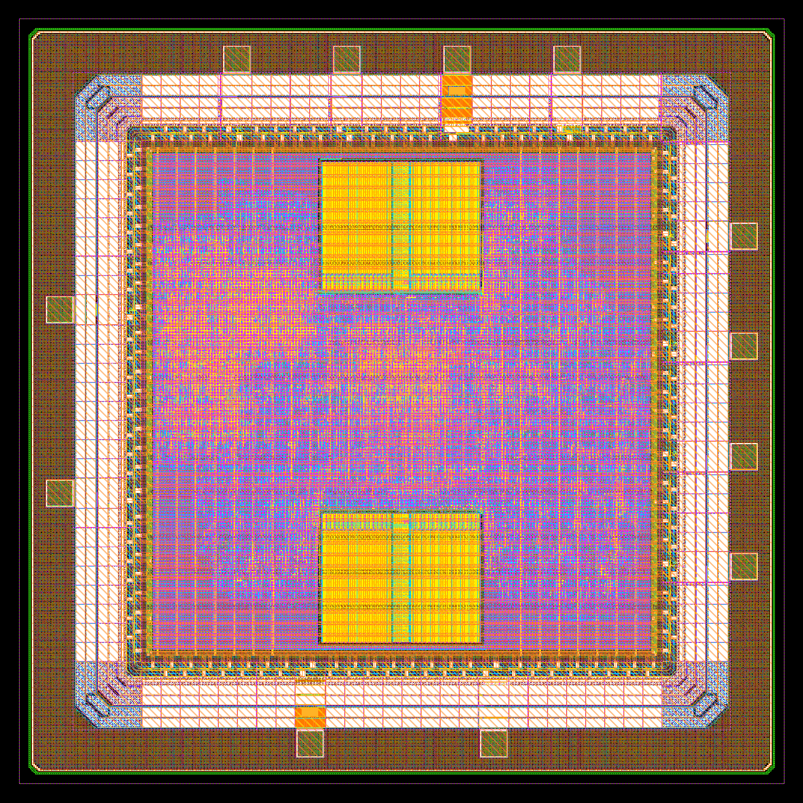
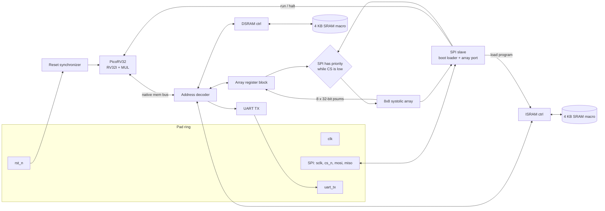

# Argo

**A RISC-V SoC with an 8x8 int8 systolic array, taken from RTL to signoff-clean GDS on IHP's open 130 nm SG13CMOS5L process using only open-source tools and KLayout-only signoff.**

Argo pairs a PicoRV32 core with a weight-stationary matrix engine, two 4 KB IHP SRAM macros, a detachable 2 KB SRAM test block on its own supply, an SPI boot loader, a UART and a full 16-pad IO ring with bond pads. The whole chip passes IHP's KLayout DRC, density, antenna and LVS decks, and the routed netlist boots and runs its self-checking firmware, including a power-on self-test of every memory, in gate-level simulation. It is planned for fabrication through IHP.



*Full chip, 2.2 x 2.2 mm. The two yellow blocks are the instruction and data SRAMs. The pad ring and bond pads run around the edge, and the seal ring sits at the outer border.*


---

## Contents

1. [At a glance](#at-a-glance)
2. [Architecture](#architecture)
3. [Memory map](#memory-map)
4. [CPU](#cpu)
5. [Systolic array accelerator](#systolic-array-accelerator)
6. [Memory subsystem](#memory-subsystem)
7. [SPI boot loader and array port](#spi-boot-loader-and-array-port)
8. [UART](#uart)
9. [Clock, reset and constraints](#clock-reset-and-constraints)
10. [Pad ring and pinout](#pad-ring-and-pinout)
11. [Physical design](#physical-design)
12. [Results](#results)
13. [Verification](#verification)
14. [KLayout-only signoff: what it took](#klayout-only-signoff-what-it-took)
15. [Known limits](#known-limits)
16. [Repository layout](#repository-layout)
17. [Reproducing](#reproducing)
18. [Tool versions](#tool-versions)

---

## At a glance

| | |
|---|---|
| Process | IHP SG13CMOS5L, 130 nm CMOS, 5 metal layers, 1.2 V core |
| Die | 2.0 x 2.0 mm (core 1.3 x 1.3 mm) |
| CPU | PicoRV32, RV32I + hardware multiply, booted over SPI |
| Accelerator | 8x8 weight-stationary systolic array, signed int8 inputs, 32-bit accumulators |
| Peak compute | 64 MACs per cycle, 6.4 GMAC/s at 100 MHz |
| Memory | 2 x 4 KB `RM_IHPSG13_1P_1024x32` SRAM macros (instruction and data) |
| Peripherals | SPI slave (boot loader plus direct array access), 8N1 UART TX at 115200 baud |
| IO | 16 pads: 7 inputs, 2 outputs (16 mA), 7 power (two core VDD/VSS pairs, IOVDD/IOVSS, VDD_SRAM), plus 4 corners and 70 x 70 um bond pads |
| Clock | 100 MHz at typical and fast corners, about 85 MHz worst case (slow corner) |
| Size | 68,711 standard cells, 5,343 flip-flops, 62% standard cell utilization |
| Power | About 44 mW total (typical corner, default switching activity) |
| Flow | LibreLane 3.0.14 (Chip flow), Yosys, OpenROAD, KLayout, Icarus Verilog |
| Signoff | KLayout DRC, density, antenna and LVS: all clean |

---

## Architecture



There are two ways in:

- **The CPU path.** Firmware runs on PicoRV32 and drives the array through memory-mapped registers at `0x1000_0000`. Results come back over the UART.
- **The SPI path.** An external host loads weights and activations straight into the array and reads the results back, with no CPU involved. The same SPI port also loads firmware into the instruction SRAM and releases the CPU from reset.

The SPI slave takes priority over the CPU on the array's inputs whenever chip select is low, through a mux in `soc_top.sv`.

---

## Memory map

| Address range | Size | Device | Access |
|---|---|---|---|
| `0x0000_0000 - 0x0000_0FFF` | 4 KB | Instruction SRAM | Fetch, load, store. Code, rodata and initialized data live here |
| `0x0001_0000 - 0x0001_0FFF` | 4 KB | Data SRAM | Load and store. BSS and stack live here |
| `0x1000_0000 - 0x1000_00FF` | 32 B used | Systolic array registers | See the register map below |
| `0x2000_0000` | 1 word | UART | Write: send a byte. Read: bit 0 = TX ready |

The decoder only compares the upper address bits, so each SRAM aliases across its 64 KB window. An access to an unmapped address never gets `mem_ready`, so the CPU stalls on purpose.

---

## CPU

PicoRV32 (YosysHQ, ISC license), vendored in `picorv32/`. It's configured for area and for timing at 100 MHz:

| Parameter | Value | Why |
|---|---|---|
| `ENABLE_MUL` | 1 | Hardware multiply for the firmware's reference math |
| `ENABLE_FAST_MUL` | 0 | The single-cycle multiplier misses 100 MHz at the slow corner |
| `ENABLE_DIV` | 0 | Saves area. Firmware must avoid divide instructions |
| `COMPRESSED_ISA` | 0 | Removing the RVC decode logic cut a critical path |
| `ENABLE_IRQ` | 0 | Interrupt logic sat on a critical path and the firmware doesn't use it |
| `ENABLE_COUNTERS` | 1 | `mcycle` and `minstret` for profiling |
| `TWO_STAGE_SHIFT` / `BARREL_SHIFTER` | 1 / 0 | Smaller shifter |
| `PROGADDR_RESET` | `0x0000_0000` | Start of the instruction SRAM |

Firmware is built with `riscv64-unknown-elf-gcc -march=rv32im -mabi=ilp32`. `start.S` sets the stack to the top of the data SRAM, clears BSS and calls `main`.

---

## Systolic array accelerator

### Dataflow

The array is **weight-stationary**. Each of the 64 processing elements (PEs) holds one int8 weight in a register. Activations flow left to right along each row, and partial sums flow top to bottom down each column. The bottom of column `c` produces

```
psum[c] = sum over r of W[r][c] * A[r]       (r = 0..7)
```

so one pass computes an 8-element vector times an 8x8 matrix: 64 multiply-accumulates.

### Processing element (`pe.sv`)

Each PE does one signed 8 x 8 multiply and a 32-bit add per cycle:

```verilog
wire signed [15:0] prod = $signed(weight_reg) * $signed(act_in);
psum_out <= psum_in + {{16{prod[15]}}, prod};   // explicit sign extension
act_out  <= act_in;                              // pass activation to the right
```

The product is computed on its own and sign-extended by hand. Mixing a signed product with the unsigned `psum_in` in one expression would quietly turn the whole add unsigned under Verilog's signedness rules. That bug is easy to miss in simulation with positive-only test data, so the tests deliberately use negative values and the -128 corner.

The worst-case column sum is 8 x (-128 x -128) = 131,072, so a 32-bit accumulator never overflows.

### Pipeline

| Stage | What happens |
|---|---|
| 1-2 | Two input registers on every activation row |
| 3-10 | Eight PE rows, one cycle per row for partial sums and one cycle per column for activations |
| 11-12 | Two output registers on every column |

Activations are applied to all eight rows at the same time and held steady. Because of the one-cycle horizontal hop between PEs, column `k` settles about 20 + k cycles after the activations change. Firmware writes the activation vector, waits a fixed delay well past that point, then reads the eight results.

### Register map (base `0x1000_0000`)

| Offset | Name | Access | Description |
|---|---|---|---|
| `0x00` | `WEIGHT_ROW` | R/W | Row index (0-7) for the next weight load |
| `0x04` | `WEIGHT_DATA_LO` | R/W | Weights for columns 0-3, one byte each |
| `0x08` | `WEIGHT_DATA_HI` | R/W | Weights for columns 4-7 |
| `0x0C` | `WEIGHT_LOAD` | W | Any write pulses `weight_load` for one cycle into the selected row |
| `0x10` | `ACT_LO` | R/W | Activations for rows 0-3, one byte each |
| `0x14` | `ACT_HI` | R/W | Activations for rows 4-7 |
| `0x18` | `PSUM_SEL` | R/W | Output column to read (0-7) |
| `0x1C` | `PSUM_DATA` | R | 32-bit signed result for the selected column |

All registers respond in one cycle. The block sits on PicoRV32's native memory bus with an AXI-Lite-style register layout. It is not a full AXI-Lite interface.

### Using it from C

```c
for (int r = 0; r < 8; r++) {          // load the weight matrix, one row at a time
    SA_WEIGHT_ROW  = r;
    SA_WEIGHT_LO   = pack4(&W[r][0]);
    SA_WEIGHT_HI   = pack4(&W[r][4]);
    SA_WEIGHT_LOAD = 1;
}
SA_ACT_LO = pack4(&A[0]);              // apply the activation vector
SA_ACT_HI = pack4(&A[4]);
for (volatile int d = 0; d < 64; d++); // wait for the pipeline to settle
for (int c = 0; c < 8; c++) {          // read the eight results
    SA_PSUM_SEL = c;
    result[c] = SA_PSUM_DATA;
}
```

Weights stay loaded, so many activation vectors can run against the same matrix without reloading.

---

## Memory subsystem

Both memories are real IHP macros, `RM_IHPSG13_1P_1024x32_c2_bm_bist`: 1024 words x 32 bits, single port, with a per-bit write mask. Each one is wrapped by `sram_word_ctrl.sv`, which:

- converts PicoRV32's byte strobes into the macro's 32-bit `A_BM` bit mask, so byte and halfword stores finish in one pass with no read-modify-write
- registers address, data and enables, so every macro input comes straight from a flop
- returns `ready` two cycles after `valid` for both reads and writes
- ties off the BIST port and sets `A_DLY` as the datasheet requires

The instruction SRAM has a second write port through a mux. While the CPU is held in reset, the SPI boot loader owns it. Once the CPU runs, the CPU owns it.

Both macros are placed by hand: the instruction SRAM at (790, 370) flipped, and the data SRAM at (790, 1290). Each has a 90 um power halo, and both `VDD!` and `VDDARRAY!` are tied to the core supply.

---

## SPI boot loader and array port

`spi_slave.sv` is a mode 0 (CPOL = 0, CPHA = 0) SPI slave. SCLK, CS and MOSI are oversampled in the 100 MHz clock domain through 2-3 flop synchronizers, so SCLK must stay at or below clk/10 (10 MHz).

| Command | Frame | Action |
|---|---|---|
| `0x01` | `[01][row][w0..w7]` | Load one weight row |
| `0x02` | `[02][a0..a7]` | Apply an activation vector |
| `0x03` | `[03]` then 32 bytes out | Read all eight 32-bit column results |
| `0x04` | `[04]` | Reset the array |
| `0x05` | `[05][addr_hi][addr_lo][d3][d2][d1][d0]` | Write one word into the instruction SRAM (ignored while the CPU runs) |
| `0x06` | `[06]` | Release the CPU from reset |
| `0x07` | `[07]` | Put the CPU back in reset, for reloading |

**Boot sequence:**
1. At power-up the CPU is held in reset. `cpu_resetn = rst_sync AND cpu_run`, and `cpu_run` starts at 0.
2. The host streams the program in, one `0x05` frame per word.
3. The host sends `0x06`. The CPU starts at `0x0000_0000`.

The 307-word `sa_test` program loads in about 1.8 ms at 5 MHz SCLK.

---

## UART

`uart_tx.sv` is a minimal 8N1 transmitter at 115200 baud (868 clocks per bit at 100 MHz). The CPU writes a byte to `0x2000_0000` and polls bit 0 of the same address for TX ready. The `uart_rx` pad exists, but nothing uses it in this version.

---

## Clock, reset and constraints

- **Clock:** one 100 MHz clock from the `clk` pad. The clock tree is built by OpenROAD CTS: 1,148 clock buffers and 441 clock inverters.
- **Reset:** `rst_n` is asynchronous active-low. A two-flop synchronizer asserts asynchronously and releases on a clock edge, and every internal block uses the synchronized reset. The systolic array's reset goes through a registered mux, so switching between the CPU and SPI can't glitch it.

The SDC is `soc_padframe.sdc`:

| Constraint | Value |
|---|---|
| Clock period | 10.0 ns |
| Setup uncertainty | 0.25 ns |
| Hold uncertainty | 0.10 ns |
| Clock transition | 0.15 ns |
| Inputs | False paths. Reset is asynchronous, and the SPI and UART inputs are synchronized internally |
| Outputs | 2.0 ns output delay on `uart_tx` and `spi_miso`, both driven from flops |

---

## Pad ring and pinout

| Side | Pad | Cell | Function |
|---|---|---|---|
| North | `clk_pad` | `sg13cmos5l_IOPadIn` | Clock input |
| North | `rst_n_pad` | `sg13cmos5l_IOPadIn` | Active-low reset |
| North | `vdd_pad` | `sg13cmos5l_IOPadVdd` | Core supply (1.2 V) |
| North | `vss_pad` | `sg13cmos5l_IOPadVss` | Core ground |
| West | `input_PAD[0]` | `sg13cmos5l_IOPadIn` | `uart_rx` (unused) |
| West | `output_PAD[0]` | `sg13cmos5l_IOPadOut16mA` | `uart_tx` |
| East | `input_PAD[1]` | `sg13cmos5l_IOPadIn` | `spi_clk` |
| East | `input_PAD[2]` | `sg13cmos5l_IOPadIn` | `spi_cs_n` |
| East | `input_PAD[3]` | `sg13cmos5l_IOPadIn` | `spi_mosi` |
| East | `output_PAD[1]` | `sg13cmos5l_IOPadOut16mA` | `spi_miso` |
| South | `iovdd_pad` | `sg13cmos5l_IOPadIOVdd` | IO supply |
| South | `iovss_pad` | `sg13cmos5l_IOPadIOVss` | IO ground |

Each IO pad gets a 70 x 70 um bond pad on TopMetal1, offset (5, -70) um from the pad cell, which matches the PDK's own pad config. The PDK doesn't ship a bond pad cell, so `bondpad/` holds one generated with the PDK's `bondpad.py` script. The ring is closed with four `sg13cmos5l_Corner` cells and 122 filler cells, and a core power ring connects to the supply pads.

---

## Physical design

The flow is LibreLane's **Chip** flow, configured in `config.yaml`. Every Magic and Netgen step is removed or replaced, since Magic has no SG13CMOS5L support:

| Default step | In this flow |
|---|---|
| `Magic.StreamOut` | Removed. KLayout streams out the GDS |
| `Magic.DRC` | Removed. KLayout DRC with IHP's deck |
| `Magic.SpiceExtraction` | Replaced by `OpenROAD.WriteCDL` |
| `Netgen.LVS` | Replaced by `KLayout.LVS`, using the local deck in `lvs_local/` |
| `KLayout.XOR`, illegal overlap check | Removed. Both depend on a Magic stream-out |

**Floorplan.** The die is 2000 x 2000 um and the core is 1300 x 1300 um, with the two SRAMs stacked in the middle of the core.

**Power grid.** A custom PDN (`pdn_cfg_cmos5l.tcl`) builds a 5 um core ring connected to the pads, with straps at a 30 um pitch and dedicated macro connections. Static IR drop is under 0.1 mV, though that analysis uses default switching activity.

**Placement, CTS and routing.** These are standard LibreLane steps, with timing repair after global routing and a hold margin of 0.05 ns during placement. Detailed routing converges from 11,066 DRC violations on the first iteration to 0 on the sixth. Total wire length is 1.93 m.

**Antenna.** The router inserts 1,270 diodes. Its own checker still flags 152 nets, but IHP's KLayout antenna deck, which is the signoff check, reports 0.

**Fill.** The PDK fill script runs first, then a shaped top-up fill in `fill_local/` raises Metal2 and Metal3 from below 25% to 29% density.

---

## Results

The tables in this section are from the v1 run `c5l_v3` (12 pads, no SRAM test block). v2.2 numbers are in the update section below, and its full metrics are in `results/metrics.json` (run `sram_full6`).

### Signoff

| Check | Tool | Result |
|---|---|---|
| DRC | KLayout, IHP deck | **0** |
| Metal density | KLayout | **0** |
| Antenna | KLayout | **0** |
| LVS | KLayout | **Netlists match** |
| Router DRC | OpenROAD | **0** |
| Power grid connectivity | OpenROAD | **0** violations |
| Gate-level simulation | Icarus + SDF | **hello and sa_test both PASS** |

### Timing (10 ns clock)

| Corner | Setup WNS | Setup TNS | Failing endpoints | Hold WNS |
|---|---|---|---|---|
| Fast, 1.32 V, -40 C | +5.23 ns | 0 | 0 | +0.03 ns |
| Typical, 1.20 V, 25 C | +2.65 ns | 0 | 0 | +0.13 ns |
| Slow, 1.08 V, 125 C | -1.66 ns | -211 ns | 512 | +0.26 ns |

Hold is met at every corner on top of the 0.10 ns hold uncertainty in the SDC. Because of that, the chip works correctly at any clock up to its setup limit. The worst hold path, at the fast corner, is a short PE-to-PE hop inside the array. A worst-case part on a low supply at 125 C needs a clock of about 85 MHz.

### Area

| Component | Area (mm²) | Count |
|---|---|---|
| Standard cells | 0.872 | 68,711 |
| SRAM macros | 0.280 | 2 |
| IO pads and fillers | 1.109 | 12 pads, 122 fillers |
| Bond pads | 0.059 | 12 |
| Die | 4.000 | |

The standard cell count breaks down as:

| Class | Count |
|---|---|
| Combinational | 50,829 |
| Flip-flops | 5,343 |
| Timing repair buffers | 5,111 |
| Antenna cells | 4,552 |
| Inverters | 1,286 |
| Clock buffers and inverters | 1,589 |

### Power (typical corner)

| | |
|---|---|
| Internal | 37.4 mW |
| Switching | 7.0 mW |
| Leakage | 11 uW |
| **Total** | **44.5 mW** |

This is OpenROAD's estimate with default activity factors, not from a simulation activity file.

---

## Verification

Every test checks itself and prints PASS or FAIL. None of them need anyone to look at waveforms.

| Test | Level | What it checks |
|---|---|---|
| `tb_boot` | RTL | The CPU is held in reset at power-up. A program loads over SPI, the CPU boots and prints `OK` over the UART. The testbench decodes the UART line at 115200 baud |
| `tb_spi` | RTL | Loads weights and activations over SPI, reads all 8 results back and compares them against a reference model. Four vector sets cover mixed signs, all -128 (the maximum positive sum) and all +127 |
| `hello` | RTL | Firmware boots over SPI and prints `HI` |
| `sa_test` | RTL | Firmware drives the array through MMIO. Five vector sets over three weight matrices, each checked against the CPU's own multiply. It covers mixed signs, a one-hot -1 (output = -W[3][c]), the -128 corner and a full matrix reload |
| `sram_test` | RTL | March and address tests on the 2 KB SRAM test block, plus the detached case (`sram_en` low) with the macro outputs forced to X |
| `post` | RTL | Power-on self-test: march tests on free ISRAM, DSRAM and the SRAM block, plus an array known-answer check. Prints `POST:I+D+A+S+`, or `S0` with the block detached |
| `hello` (GLS) | Gate level | Same as above, on the routed v2.2 netlist |
| `sa_test` (GLS) | Gate level | Same as above, including the full 307-word SPI boot, about 2.9 ms of simulated time |
| `post` (GLS) | Gate level | Both strap settings on the routed netlist, about 16 ms and 13 ms of simulated time. `WAIVERS.md` (W5) explains how the CPU's non-reset flops are initialized |
| `post` (GLS, SDF) | Gate level | Same, with typical-corner SDF cell delays. Results match the zero-delay runs cycle for cycle |

The RTL tests run against IHP's own behavioral SRAM models, not an idealized memory, so the macro's timing contract is exercised too. Gate-level simulation uses the final netlist with the PDK's standard cell, IO and SRAM Verilog models.

```
$ ./run_regress.sh
PASS  tb_boot
PASS  tb_spi
PASS  hello
PASS  sa_test
```

---

## KLayout-only signoff: what it took

SG13CMOS5L is new, and taking a chip through signoff with KLayout alone needed several workarounds. Each one is in this repo and none of them hide a check.

| Problem | Fix | Files |
|---|---|---|
| The PDK pad netlist has a pin-count error on two lines, and KLayout LVS aborts on it | Corrected copy of the pad CDL | `sg13cmos5l_io_fixed.cdl` |
| 10 PDK cells (9 pad internals, 1 SRAM dummy) fail LVS against their own layouts | Black-boxed in a local copy of the LVS deck | `lvs_local/`, `mk_lvs_local.sh` |
| The SRAM macro LVS compare runs for hours without finishing | SRAM macros black-boxed | `lvs_local/` |
| Stock fill leaves Metal2 and Metal3 under the 25% density minimum | Shaped top-up fill raises both to 29% | `fill_local/` |
| Decap cells in gap fill landed under Metal1 routes (985 DRC errors) | Gap fill uses plain fill cells | `config.yaml` (`DECAP_CELLS`) |
| The PDK has no bond pad cell, and its generator crashes writing the LEF | Generated the GDS, moved it to a lower-left origin, wrote the LEF by hand as `CLASS COVER` | `bondpad/` |
| Bond pads plus IO terminals gave each port two pins, a router error (DRT-0302) | The bond pad carries the only terminal | `config.yaml` |
| Several LibreLane scripts assume Magic or SG13G2 conventions | 10 script changes (antenna repair, GRT, IO, global connections, RC, CTS, DRT, RC dump, STA corners, Yosys common) | `librelane-3.0.14-local.patch`, `librelane_scripts/` |
| Icarus crashes on SDF interconnect delays | GLS strips interconnect delays and keeps cell delays | `run_gls.sh` |

Timing-driven RTL changes made along the way:
- a two-flop reset synchronizer, since the raw pad reset was driving 11 internal resets
- `COMPRESSED_ISA=0` and `ENABLE_IRQ=0`, which removed logic from the critical path
- a multi-cycle multiplier
- a registered reset mux for the array

---

## Known limits

- **LVS coverage** is the standard cells and the top-level wiring. Pads and SRAM macros are black-boxed. SRAM hookup is checked three other ways: a pin check against the RTL, gate-level simulation, and a count of power vias on every supply stripe (`count_sram_vias.py`, `sram_pins.py`).
- **Slow corner timing.** Setup misses 100 MHz by 1.66 ns. A few high-fanout decode nets (`a21oi_2` drivers with 40 to 100 loads) also cause 876 slew violations at the slow corner and 171 max-fanout violations at all corners. Max capacitance is 0 everywhere. A larger repair slew margin should fix the slew. It wasn't applied, since typical and fast pass and hold is met at every corner.
- **No array status register.** The array's `done` pulse only went to the interrupt line, which is disabled, so firmware waits a fixed delay instead of polling. The delay has a wide margin over the 27-cycle pipeline.
- **No divide.** `ENABLE_DIV=0`, so the firmware must not use divide or remainder instructions.
- **UART RX** has a pad but no receiver.
- **Timing was extracted before metal fill.** Fill adds coupling capacitance that this STA doesn't see.
- **Fill rules.** The top-up fill uses 0.42 um spacing and 1.0 um minimum width. The tech file lists stricter values (`MFil_b` 0.6 um, `MFil_a1` 2.0 um) that the DRC deck doesn't check. Waiting on confirmation from IHP.
- **Power numbers** use default activity factors, not simulation activity.

---

## Repository layout

```
soc_padframe.sv               pad ring and top level
soc_top.sv                    SoC: CPU, decoder, SRAM controllers, UART, array, SPI
picorv32/                     PicoRV32 core (YosysHQ, ISC license)
systolic_array.sv, pe.sv      8x8 systolic array and processing element
axilite_slave.sv              array register block
spi_slave.sv                  SPI boot loader and array port
sram_word_ctrl.sv             IHP SRAM macro controller
uart_tx.sv                    UART transmitter
*_stub.v                      black-box models for synthesis
config.yaml                   LibreLane configuration
soc_padframe.sdc              timing constraints
pdn_cfg_cmos5l.tcl            power grid
firmware/                     start.S, linker script, hello.c, sa_test.c, Makefile
tb/                           RTL testbenches (tb_gls.sv is generated by run_gls.sh)
run_regress.sh                RTL regression, 4 tests
run_gls.sh                    gate-level simulation on the routed netlist
lvs_local/, mk_lvs_local.sh   local KLayout LVS deck with black-box support
fill_local/                   shaped top-up metal fill
bondpad/                      70 x 70 um bond pad (GDS, LEF, Verilog stub)
sg13cmos5l_io_fixed.cdl       pad netlist with the PDK pin-count fix
count_sram_vias.py, sram_pins.py   SRAM hookup checks
librelane-3.0.14-local.patch  local LibreLane script changes
librelane_scripts/            the same changes as plain files, for reading
results/                      GDS, final netlist, typical SDF, metrics, GLS and LVS logs
bright.lyp                    KLayout layer colors used for the layout image
TOOL_VERSIONS.txt             exact tool versions on the reference machine
docs/                         images
```

---

## Reproducing

You need the IHP open PDK with SG13CMOS5L (`dev` branch), LibreLane 3.0.14, OSS CAD Suite (Yosys, Icarus) and OpenROAD and KLayout 0.30.

```bash
# 1. Apply the local LibreLane changes to a clean 3.0.14 install
pip install librelane==3.0.14
patch -p1 -d $(python3 -c "import librelane,os;print(os.path.dirname(os.path.dirname(librelane.__file__)))") < librelane-3.0.14-local.patch

# 2. Point the scripts at your PDK checkout (the folder that contains ihp-sg13cmos5l/)
export CMOS5L_PDK_ROOT=/path/to/IHP-Open-PDK

# 3. RTL regression (about a minute)
./run_regress.sh

# 4. RTL to GDS with full KLayout signoff (several hours, DRC is the long step)
python3 -m librelane --manual-pdk --pdk-root $CMOS5L_PDK_ROOT --pdk ihp-sg13cmos5l \
  --scl sg13cmos5l_stdcell --run-tag v22 config.yaml

# 5. Signoff gate, then gate-level simulation on the routed netlist (about 1 hour for all four)
./signoff_check.sh v22
python3 gls_xinit.py runs/v22/final/nl/soc_padframe.nl.v 'i_soc_top\.u_cpu\.' > tb/gls_xinit.svh
export RUN=runs/v22/final PROBE=tb/gls_xinit.svh
./run_gls.sh hello zero 6000 1
./run_gls.sh sa_test zero 8000 1
./run_gls.sh post zero 40000 1
./run_gls.sh post zero 40000 0
```

To run gate-level simulation on the prebuilt results without running the flow:

```bash
mkdir -p prebuilt/nl prebuilt/sdf
gunzip -c results/soc_padframe.nl.v.gz   > prebuilt/nl/soc_padframe.nl.v
gunzip -c results/soc_padframe_typ.sdf.gz > prebuilt/sdf/soc_padframe_typ.sdf
python3 gls_xinit.py prebuilt/nl/soc_padframe.nl.v 'i_soc_top\.u_cpu\.' > tb/gls_xinit.svh
RUN=prebuilt PROBE=tb/gls_xinit.svh ./run_gls.sh sa_test zero 8000 1
```

To view the layout:

```bash
gunzip -k results/argo_soc_padframe.gds.gz
klayout -nn $CMOS5L_PDK_ROOT/ihp-sg13cmos5l/libs.tech/klayout/tech/sg13cmos5l.lyt -l bright.lyp results/argo_soc_padframe.gds
```

---

## Tool versions

| Tool | Version |
|---|---|
| IHP Open PDK | `dev` branch, commit `bf07902` (2026-10-02) |
| LibreLane | 3.0.14 + local patch |
| OpenROAD | v2.0-17598-ga008522d8 |
| Yosys | 0.49 |
| OpenSTA | 2.7.0 |
| KLayout | 0.30.5 |
| Icarus Verilog | 14.0 (devel) |
| Verilator | 5.053 (devel) |
| RISC-V GCC | 13.2.0 |
| Magic / Netgen | not used |

The full list is in `TOOL_VERSIONS.txt`.

---
## Update: SRAM test block (October 2026)

Argo now carries a 512x32 SRAM test block (byte write enables) generated with an open-source SRAM compiler, placed in the top-right corner of the core next to the two IHP 4 KB macros. Its purpose is to validate the compiler on IHP silicon, so it is fully detachable:

- Own supply, `VDD_SRAM`, through a dedicated analog pad, tied into a separate core ring and Metal4 straps by `sram_test/vddsram_strap.tcl`.
- `sram_en` strap pad. When low, the macro clock is gated, its inputs are forced to 0 and its outputs are masked, so the rest of the chip runs normally even if the SRAM is dead.
- Memory map: `0x3000_0000`-`0x3000_07FC` data, `0x3000_1000` status/ID register.
- Firmware `firmware/sram_test.c` runs March C-, address-in-data and byte/halfword lane tests.

The die is now 2.2 x 2.2 mm with 16 pads, including a second VDD/VSS pair for power delivery. See [docs/DATASHEET.md](docs/DATASHEET.md) and [docs/BRINGUP.md](docs/BRINGUP.md). Signoff (KLayout only): DRC 0, LVS 0, density 0, antenna 0, route DRC 0. Typical corner setup slack +2.35 ns. Registering the CPU reset that drives the register-file write enables cut slow-corner TNS from -211 ns to -18.7 ns; with the second supply pad pair the slow corner sits at -2.07 ns WNS (about 83 MHz worst case).

**v2.2.** Capping the resizer's wire length at 600 um made the flow buffer the long `mem_wdata` bus instead of hanging up to 200 antenna diodes on each bit. Slow-corner WNS improved from -2.07 ns to -1.38 ns (about 88 MHz worst case), typical-corner slack to +2.82 ns, slew violations dropped from 1,297 to 66 and antenna diodes from 2,086 to 1,266. Signoff is still clean, checked by `signoff_check.sh`. Gate-level simulation now runs the power-on self-test on the routed netlist in both strap settings. The remaining waivers are listed in [WAIVERS.md](WAIVERS.md).

Regression: `./ci_regress.sh` builds the firmware and runs 12 tests (both `sram_en` settings plus forced-X fault cases). Set `CMOS5L_PDK_ROOT` to your IHP-Open-PDK checkout.

Note: the generated SRAM macro views (GDS, LEF, SPICE, Liberty) are not included in this repo yet. `sram_test/sram_views.py` and `migrate_memgen.sh` rebuild them from the compiler output. The Liberty is a placeholder until characterized timing is available.

---
## Acknowledgments

Built in collaboration with Symbiotic EDA. Uses the IHP open PDK, LibreLane, OpenROAD, Yosys, KLayout, Icarus Verilog and PicoRV32.

---
## Author

Rakshith Suresh, MS Electrical Engineering, USC Viterbi
